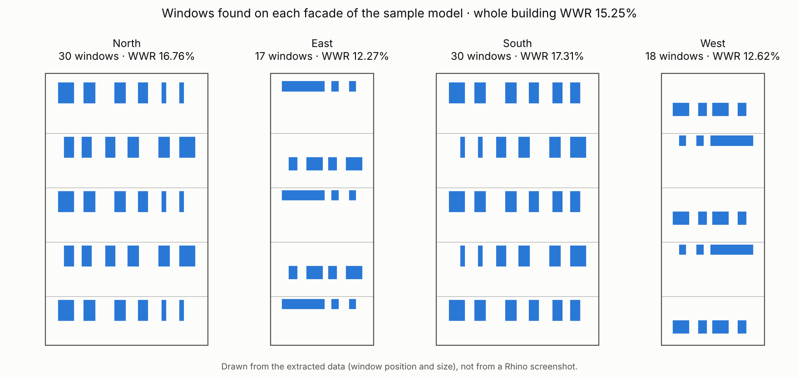

# Rhino window extractor

A Python script that reads a Rhino `.3dm` building model, turns every window into a row in a spreadsheet, and works out the window-to-wall ratio of each facade.

I wrote the first version in May 2020 for a window take-off task with View Inc. In November 2026 I added the command-line script and the window-to-wall ratio, with help from Claude, an AI assistant.



## What you get

On the sample 5-floor model the script finds 95 windows and writes two files.

`output/windows.csv` has one row per window:

| index | name | floor | orientation | width | height | depth | area |
|---|---|---|---|---|---|---|---|
| 1 | F0E1 | 0 | E | 8.01 | 2.02 | 0.17 | 16.17 |
| 2 | F0E2 | 0 | E | 1.46 | 2.02 | 0.17 | 2.94 |
| 3 | F0E3 | 0 | E | 1.46 | 2.02 | 0.17 | 2.94 |
| 4 | F0N4 | 0 | N | 3.14 | 4.05 | 0.17 | 12.71 |

`output/wwr_by_orientation.csv` has one row per facade:

| orientation | windows | window_area | wall_area | wwr_percent |
|---|---|---|---|---|
| N | 30 | 252.68 | 1507.85 | 16.76 |
| E | 17 | 117.13 | 954.97 | 12.27 |
| S | 30 | 261.02 | 1507.85 | 17.31 |
| W | 18 | 120.54 | 954.97 | 12.62 |
| Total | 95 | 751.38 | 4925.64 | 15.25 |

Lengths and areas are in the model's units. The sample model is in feet.

## Run it

```bash
pip install rhino3dm pandas numpy
python window_extractor.py building_model_5floor.3dm --out output
```

You don't need Rhino installed. `rhino3dm` reads the file directly.

## How it works

1. Opens the model with `rhino3dm` and finds every object named `window`.
2. Reads each window's bounding box to get width, height, depth and area.
3. Works out which way each window faces (N, S, E or W) from its position relative to the building's center.
4. Finds each window's floor by comparing its height with the floor slabs (objects named `floor`).
5. Names each window by floor, direction and number, for example `F1N15`. Within a facade, windows are numbered by position.
6. Adds up the window area on each facade and divides it by that facade's wall area. The wall area is the facade's overall width times the total wall height, taken from the objects named `wall`.

## What your model needs

- Windows, walls and floor slabs are objects named `window`, `wall` and `floor`.
- The building is a rectangle lined up with the X and Y axes, with +Y as north.

Window sizes come from bounding boxes, so a window that isn't a rectangle is counted as its bounding rectangle.

## Files

- `window_extractor.py`: the script
- `rhino3d_windows_information.ipynb`: the original 2020 notebook, with the method written out step by step
- `building_model_5floor.3dm`: the sample 5-floor model
- `output/`: what the script writes for the sample model
- `windows_information.csv`: the 2020 notebook's output. It has the same 95 windows. The numbers inside each name differ from `output/windows.csv`, because the notebook didn't number windows by position.
- `docs/facades.png` and `docs/make_figure.py`: the picture above and the script that draws it
